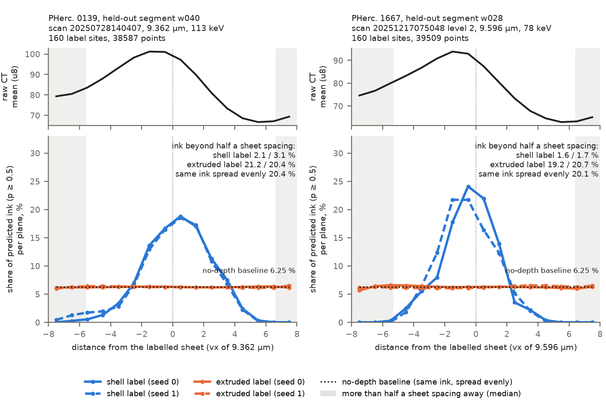

# vesuvius-label-j: keep 3D ink on its own sheet

3D ink models trained on labels copied through the depth of the slab ("extruded" labels) put ink above and below the
labelled sheet. This repository changes only the training label: ink on a thin shell at the
labelled surface (±1.5 voxels), "no ink" on the rest of the slab (±7.5 voxels) for every labelled pixel, and the depth
frame of each training crop shifted at random by up to ±6 voxels. With that label the net puts its ink on the sheet
the label belongs to.

It also holds the measure used to show this: at labelled ink spots, the share of predicted ink (p ≥ 0.5) that lies
more than half a sheet spacing away from the labelled sheet along the surface normal (the "leak" L), next to a
no-depth baseline L0 (the same predicted ink spread evenly over the slab, which is what a net with no depth
information would give). L reads only the ±7.5 voxels around the labelled surface, the same slab in which the shell
label trains every voxel off the shell to 0; it does not show where the ink goes further out, on the neighbouring
wraps (the median distance to the next sheet's centre, ~12.5 voxels, lies outside this window).



*Predicted ink by depth at labelled ink spots, one held-out segment per scroll (the one with the median shell-label
score: PHerc. 0139 w040, PHerc. 1667 w028), 160 labelled spots each, scored by nets that never saw that segment.
Blue: shell label; orange: extruded label; dotted: no-depth baseline. Grey: more than half a sheet spacing from the
labelled sheet. Top: mean raw CT at the same spots.*

## Results

Every segment was scored only by nets that never saw any of its labels (leave one segment out, two seeds each). The
thresholds and the scoring were fixed before the runs.

| scroll, scan | held-out segments | shell label | extruded label | no-depth baseline |
|---|---|---|---|---|
| PHerc. 0139, 9.362 µm, 113 keV | 5 (w035, w039, w040, w041, w044) | 2.8 / 3.8 % | 21.3 / 20.9 % | 20.5–21.3 % |
| PHerc. 1667, 2.399 µm scan at 9.6 µm (level 2), 78 keV | 6 (w013, w018, w023, w028, w029, w031) | 1.6 / 1.4 % | 17.8 / 18.2 % | 17.9–18.2 % |

(Two values: seed 0 / seed 1; pooled over all held-out segments.) The shell label won on every held-out segment
(5 of 5 and 6 of 6). The extruded label sits on the no-depth baseline.

**Label-free held-out check (PHerc. 1667).** The 24 held-out 1667 nets (12 shell, 12 extruded) were run on 415 cm²
of newly traced PHerc. 1667 surface [credit pending] more than two sheet spacings (~54 voxels at 7.91 µm) from every
labelled point, mostly on the same wraps as the labelled segments, with ink spots
picked by the public `ink_canonical_2um` model instead of by a person. The shell label put 0.9 % of its ink more than
half a sheet spacing away, against 18.2 % for the extruded label (no-depth baselines 19.1 % and 18.3 %), in every
fold. The shell label is just as low at spots the picker called blank (0.7 %), so this shows where the ink sits, not
how much of it is real ink.

**Controls.**
- Known answers: the scorer gets planted predictions. All ink on the labelled sheet scores 0 % (500 planted spots,
  sheet spacings 4–14 voxels); all of it one sheet spacing away scores 100 % (the 162 spots where the next sheet lies
  inside the scored depth). `python shared/run_t4.py --check` runs it in a second, with no data.
- A known model in the same measure: hecate (public 9.6 µm 3D ink model) gives 4.2 % (baseline 18.4 %) on 0139,
  5.4 % (18.3 %) on 1667 and 1.7 % (18.3 %) on the fresh 1667 surface. On the labelled segments these hecate numbers
  (and its AUCs below) come from a subset of the scored spots: the 400 spots of the earlier 0139 spot list, and on
  1667 the 40 earlier spots per segment (of 160). hecate was probably trained on these labels, so on the labelled
  segments this checks the measure, not the model.
- Frame test: without the random depth shift the shell label also gives ~0 %, but because the net learned which
  plane of the crop the sheet sits in (it fires there on an empty input and does not move when the CT is shifted by
  4 voxels). With the shift the predicted ink peak moves with the CT. This runs on every held-out segment.
- Ink detection does not change consistently: ink AUC 0.74 vs 0.75 on 1667, 0.69 / 0.68 vs 0.64 / 0.65 on 0139
  (shell vs extruded, seed 0 / seed 1); hecate gives 0.85 and 0.81 on the subset above; chance is 0.5.
- On 0139 the table is the fourth registered try. The fourth used the same nets as the third (not retrained) on a
  larger, changed set of scored spots; the first three failed for named reasons (no loss off the shell, no depth
  shift, too few scored spots).

## Data it reads

All CT and labels are read from the public Vesuvius Challenge open-data bucket
(`https://vesuvius-challenge-open-data.s3.amazonaws.com`) over https; nothing is stored in this repository.

- PHerc. 0139: volume `PHerc0139/volumes/20250728140407-9.362um-1.2m-113keV-masked.zarr`; segments w035, w039, w040,
  w041, w044: mesh `segments/<seg>/mesh/<id>-on-20250728140407-9.362um.tifxyz`, labels
  `segments/<seg>/ink-labels/9.362um-volume-20250728140407/20260918` (`inklabels.zarr`, `supervision.zarr`, level 0).
  Segment folders are listed in `pherc0139/prep_data.py`.
- PHerc. 1667: volume `PHerc1667/volumes/20251217075048-2.399um-0.2m-78keV-masked.zarr`, pyramid level 2; segments
  w013, w018, w023, w028, w029, w031: mesh `segments/<seg>/mesh/<id>-on-20251217075048-2.399um.tifxyz`, labels
  `segments/<seg>/ink-labels/2.399um-volume-20251217075048/20260918` (level 2). Listed in `pherc1667/prep_data.py`.
- hecate (control and spot lists): `hecate.py` and `hecate_9.6um.pth` from https://huggingface.co/scrollprize/hecate
  into `$HECATE_DIR`.
- Label-free check only: `ink_canonical_2um` (https://huggingface.co/scrollprize/ink_canonical_2um,
  `r152_3ddec_v2_l5_epoch13.ckpt`) and the fresh 1667 surface upload [credit pending], which is not redistributed here.

## Install

```
python3.12 -m venv .venv && . .venv/bin/activate
pip install -r requirements.txt
```

## Where things are

| folder | what |
|---|---|
| `shared/` | `run_t23.py` (sheet geometry, renders along the normal, CT profiles; `pr2368_band.py` finds the sheets on a profile), `run_t4.py` (leak L, no-depth baseline L0, scorer self-check) |
| `pherc0139/`, `pherc1667/` | per scroll: data prep, training (`train.py`, `heldout/train_fold.py`: the label options are `common.masks`), scored spots, inference, scorer |
| `points0139/run.py` | the 0139 spot list `points.npz` (per-point sheet spacings and hecate's output) |
| `labelfree1667/` | the label-free held-out check on fresh 1667 surface |
| `figure/` | the depth-profile figure (`depth_profile.py` from stored outputs, `plot.py` draws it) |
| `check_fold.py` | re-scores one held-out segment from stored fold outputs and compares with `results.json` |

The stored results are `pherc0139/attempt4/results.json`, `pherc1667/attempt2/results.json` and
`labelfree1667/results.json`. Folder names `attemptN/` are the registered tries; comments cite the author's internal task and
finding ids (VES-…, F-…).

## Settings (environment variables)

Every path is an environment variable with a default under `./data/`:

| variable | default | holds |
|---|---|---|
| `REPO_DATA` | `data` | 0139 meshes and labels (written by `pherc0139/prep_data.py`); 1667 meshes `pherc1667_meshes/<w>` |
| `RUN_0139` | `data/run0139` | 0139 run folder (renders, blocks, nets, outputs) |
| `POINTS_0139` | `data/points0139` | 0139 spot list `points.npz` |
| `DATA_1667` | `data/pherc1667` | 1667 level-2 meshes and labels (written by `pherc1667/prep_data.py`) |
| `RUN_1667` | `data/run1667` | 1667 run folder |
| `HECATE_DIR` | `data/models/hecate` | `hecate.py`, `hecate_9.6um.pth` |
| `RUN_LABELFREE` | `data/labelfree1667` | label-free check: run folder |
| `WILL1667_DIR` | `data/will1667/x` | label-free check: the fresh surface upload (`patch_0` … `patch_5`) |
| `TRANSFORM_2399` | `data/transform_2399.json` | label-free check: transform of the upload to scan 20251217075048 |
| `INK2UM_CKPT` | `data/models/ink_canonical_2um/r152_3ddec_v2_l5_epoch13.ckpt` | label-free check: spot picker |
| `INKCHECK_REPO` | `.` (repository root) | label-free prep only: checkout holding `tools/inkcheck/src` (see Limits) |
| `CPU_PY`, `GPU_PY` | `python` | interpreter the shell scripts call |
| `UFSM_IMAGE` | `ufsm` | Docker image of the ufsm reader (`points0139/run.py`) |

## Reproduce one held-out segment on one GPU (PHerc. 1667, w028)

```
python pherc1667/fetch_meshes.py           # 6 published meshes -> data/pherc1667_meshes
python pherc1667/prep_data.py              # level-2 meshes and labels -> data/pherc1667
cd pherc1667
./run_prep.sh                              # renders along the normal and training blocks (CPU)
./run_sites.sh                             # scored spots and per-point arrays, hecate on CPU (needs HECATE_DIR)
for s in 0 1; do $GPU_PY train.py --arm P --seed $s; done   # no-shift control nets (frame test), all segments
for arm in J D; do for s in 0 1; do        # J = shell label, D = extruded label; ~9 GPU-min each
  $GPU_PY heldout/train_fold.py --fold w028 --arm $arm --seed $s --steps 12000
done; done
$CPU_PY attempt4/infer4.py --folds w028    # the fold's nets and the control nets on the scored spots
cd .. && python check_fold.py --scroll 1667 --fold w028
```

The stored fold outputs (`RUN_0139`, `RUN_1667`: renders, nets, net outputs) are not published yet; until they are,
`check_fold.py` and `figure/depth_profile.py` need the folders you build with the steps above.

`check_fold.py` prints L and L0 for the four nets next to the stored numbers (shell label 1.56 / 1.71 %, extruded
19.25 / 20.65 %, baselines 19.7–20.7 %). With the stored fold outputs it matches them exactly; nets trained again
will not give bit-identical numbers (GPU training is not deterministic), and how close they come has not been tested
from this tree. The full run (all folds, the no-shift control nets `train.py --arm P`, the scorer
`attempt4/score4.py`) is `run_gpu.sh` / `attempt2/run_gpu_a2.sh` then `attempt2/run_score_a2.sh`;
`attempt4/score4.py --check` runs the scorer's self-tests on the prepared data. PHerc. 0139 runs the same way from
`pherc0139/` (`prep_data.py`, `prep.py`, `attempt3/prep3.py`, `points0139/run.py`, `xseg.py`, `attempt4/sites4.py`,
`heldout/run_folds.py` at 6000 steps, `attempt4/infer4.py`, `attempt4/score4.py`).

Compute: 3D U-Net (16/32/64/128 channels), batch 16; about 4 GPU-minutes per net on 0139 (6000 steps) and 9 on 1667
(12 000 steps) on one RTX PRO 6000; the final 20 + 24 held-out nets took 1.4 + 3.7 GPU-hours.

## Limits

- Shown on two scrolls, both at ~9.5 µm. On a third scroll that cannot be named yet, the same test (8 held-out
  segments, same recipe and scoring) did not confirm the result: the shell label won 3 of 8 segments against a
  pre-set bar of 7, lost none, 1 was unclear, and 4
  were void because hecate failed the per-segment control there.
- At full resolution (PHerc. 1667, 2.4 µm, level 0) the test has no result yet: the first try was void on every
  segment (the nets did not fit the training labels at the pre-set bar), and the second is running (one of six
  segments already void by the same fit control).
- The leak L reads only ±7.5 voxels around the labelled surface, the slab in which the shell label trains to 0
  off the shell; ink further out, on the neighbouring wraps, is not measured.
- Measured with this small 3D U-Net on flattened stacks, not in villa's ink trainer.
- No consistent change in ink detection and no new letters: this is about keeping ink on the labelled sheet.
- On 1667 the nets needed 12 000 steps; at 6000 they under-fit the labels.
- `points0139/run.py` also samples two community 3D ink fields for a comparison, through the `ufsm` reader
  (https://github.com/SuperOptimizer/ufsm) in Docker (image name in `UFSM_IMAGE`, default `ufsm`); it does not run without that image.
- The label-free check needs the fresh surface upload, which this repository does not include. Its prep
  (`labelfree1667/prep1.py`: renders and ink_canonical_2um spots) also imports `inkcheck`, the author's volume reader
  and ink_canonical_2um loader, which is not in this repository and not in `requirements.txt`; the scorer
  `labelfree1667/score_lf.py` and the stored spot files do not need it.
- `pherc1667/attempt2/run_score_a2.sh` writes its new score over the stored `attempt2/results.json` (compare with
  `git diff`).

## Credits

hecate (the 3D ink model used as a check) and villa (`ink_detection` native 3D training, and the sheet finder in
`shared/pr2368_band.py`, MIT, see `THIRD_PARTY.md`) by the Vesuvius Challenge and its community; the PHerc. 0139
and PHerc. 1667 ink labels from the Vesuvius Challenge open-data release 20260918; the fresh PHerc. 1667 surface by
[credit pending].

## Licence

Code: MIT, see `LICENSE`. The CT scans, meshes and ink labels the code reads are Vesuvius Challenge open data under
CC BY-NC 4.0 and are not part of this repository; hecate and ink_canonical_2um are fetched from their Hugging Face
pages under their own terms.
